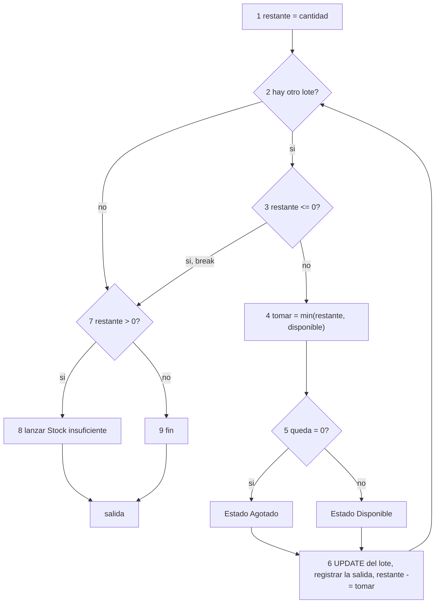
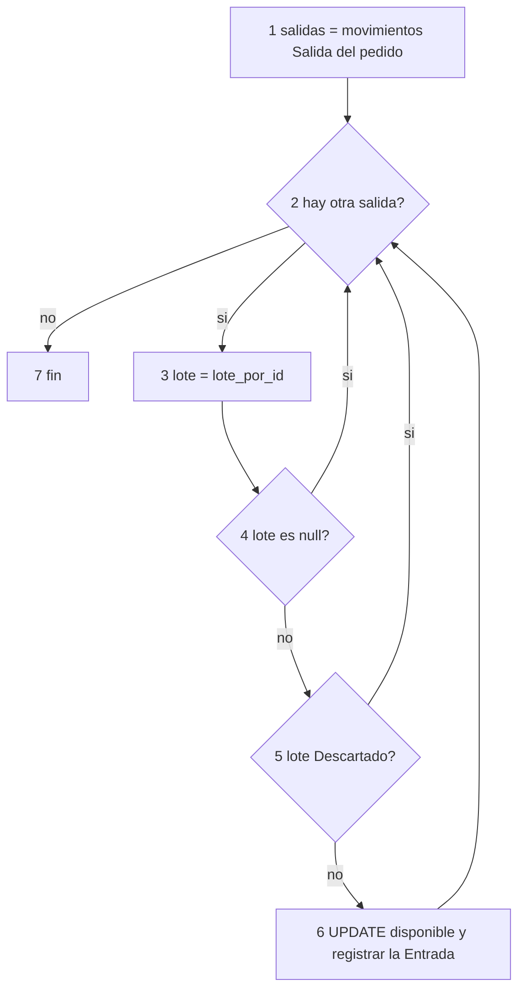

# Pruebas de caja blanca

Ingenieria de Software, tarea 6. Documento independiente del informe de caja negra
([`pruebas-caja-negra.md`](pruebas-caja-negra.md)) y del informe de defectos
([`informe-de-defectos.md`](informe-de-defectos.md)).

Una prueba de caja blanca parte del codigo: se dibuja el grafo de flujo de cada unidad,
se calcula cuantos caminos independientes tiene y se escribe un caso que recorra cada
uno. Aca las unidades son las funciones de `includes/` y `modelo/`, que se llaman
directamente desde un programa de prueba contra la base real, y dos scripts de
`acciones/`, que se analizan por ramas.

El programa se corrio dos veces: la **primera corrida** encontro los defectos y la **segunda**, despues de
corregirlos, comprobo que cada caso fallido pasa y agrego 23 casos para los caminos nuevos
([Segunda corrida](#segunda-corrida-despues-de-las-correcciones)). Las secciones de analisis describen el
codigo de la primera corrida.

## Que se hizo

1. **Medir la complejidad** de todas las unidades con
   [`pruebas-caja-blanca-complejidad.php`](pruebas-caja-blanca-complejidad.php).
2. **Elegir las unidades** con decisiones que escriben en la base o validan datos: las que
   tocan el stock, los pedidos y los estados.
3. **Dibujar el grafo de flujo** de cada una, contar sus caminos independientes y escribir
   un caso por camino en [`pruebas-caja-blanca.php`](pruebas-caja-blanca.php) (46 casos).
4. **Analizar las ramas** de `acciones/pedido_cliente.php` y `acciones/distribucion.php`
   contra los casos de caja negra y completar los que faltaban.
5. **Probar la concurrencia** del descuento de stock con varios procesos en paralelo
   ([`pruebas-caja-blanca-concurrencia.php`](pruebas-caja-blanca-concurrencia.php)).

## Entorno

| Elemento | Valor |
|---|---|
| Fecha | 08/11/2026 |
| PHP | 8.2.35 por linea de comandos (las funciones se cargan con `require`, sin servidor web) |
| Base de datos | MariaDB 10.11.19, reimportada desde `bd/atrax.sql` al empezar |
| Datos | Cada caso crea sus propios platos y lotes; no depende de los datos de ejemplo |

No se uso una herramienta de cobertura: Xdebug y pcov no estan instalados en este
equipo. La cobertura se argumenta por camino. Cada camino se diseno para que deje un
resultado observable distinto (el estado del lote, la excepcion, las filas creadas), de
modo que si el caso da lo esperado, ese camino se recorrio.

## Metodo

- **Grafo de flujo de control**: cada bloque de sentencias es un nodo y cada decision
  (`if`, `foreach`, `&&`, `||`, `?:`, `??`, `catch`) abre aristas.
- **Complejidad ciclomatica**: V(G) = E - N + 2 = decisiones + 1. Es el numero de caminos
  linealmente independientes, o sea la cantidad minima de casos para recorrer todas las
  ramas.
- **Prueba del camino base**: un caso por camino independiente. Los caminos imposibles se
  documentan, no se prueban.
- **Criterios de cobertura**: sentencia y decision en todas las unidades; **condicion**
  donde hay `&&` o `||` con dos operandos distintos (`es_fecha()`, `devolver_stock()`,
  `pedido_cliente.php`).

## Complejidad del sistema

Se midieron 117 unidades (cada funcion de `includes/` y `modelo/`, y cada script de
`acciones/` como una sola unidad). La tabla muestra las que tienen V(G) de 5 o mas; la
lista completa sale de correr el script.

| Archivo | Unidad | Lineas | V(G) | Riesgo |
|---|---|---|---|---|
| `acciones/productos.php` | `(script)` | 88 | 27 | alta |
| `acciones/pedido_cliente.php` | `(script)` | 110 | 23 | alta |
| `acciones/vehiculos.php` | `(script)` | 65 | 20 | moderada |
| `acciones/usuarios.php` | `(script)` | 77 | 19 | moderada |
| `acciones/stock.php` | `(script)` | 55 | 18 | moderada |
| `acciones/registro.php` | `(script)` | 84 | 17 | moderada |
| `acciones/distribucion.php` | `(script)` | 65 | 13 | moderada |
| `acciones/stock_minimo.php` | `(script)` | 45 | 12 | moderada |
| `acciones/zonas.php` | `(script)` | 55 | 12 | moderada |
| `acciones/produccion.php` | `(script)` | 45 | 11 | moderada |
| `acciones/acceso.php` | `(script)` | 41 | 8 | baja |
| `acciones/planes.php` | `(script)` | 30 | 8 | baja |
| `includes/error.php` | `mostrar_error()` | 49 | 8 | baja |
| `acciones/pedidos.php` | `(script)` | 34 | 7 | baja |
| `modelo/pedidos.php` | `listar_pedidos()` | 37 | 6 | baja |
| `includes/funciones.php` | `base_url()` | 15 | 5 | baja |
| `includes/funciones.php` | `validar_token()` | 9 | 5 | baja |
| `modelo/stock.php` | `descontar_fifo()` | 25 | 5 | baja |

Unidades medidas: 117. V(G) total: 370. Promedio: 3,16. Maximo: 27 (acciones/productos.php (script)). Unidades con V(G) mayor a 10: 10.

Ninguna funcion de `includes/` o `modelo/` pasa de V(G) = 8; las unidades con V(G) mayor a
10 son diez scripts de `acciones/`, donde todas las validaciones de un formulario estan
una detras de otra en el mismo archivo. Los dos mas complejos son
`acciones/productos.php` (27) y `acciones/pedido_cliente.php` (23). Es una senal para
separar las validaciones en funciones propias si el sistema sigue creciendo, y la razon
por la que sus ramas se verifican una por una mas abajo.

## Unidades analizadas

### `descontar_fifo()` en `modelo/stock.php` (V(G) = 5)

Descuenta una cantidad de un plato recorriendo los lotes por fecha de vencimiento.
Decisiones: el `foreach`, el `if ($restante <= 0)` que corta con `break`, el ternario
`$queda === 0` y el `if ($restante > 0)` final.



12 nodos y 15 aristas: V(G) = 15 - 12 + 2 = 5.

| Camino | Recorrido | Caso | Lo que se observa |
|---|---|---|---|
| R1 | 1, 2 (no), 7 (si), 8 | CB-18 | Excepcion "Stock insuficiente" sin tocar ningun lote |
| R2 | 1, 2, 3 (no), 4, 5 (si), 6, 2 (no), 7 (no), 9 | CB-19 | Lote en `0/10 Agotado` y una salida |
| R3 | 1, 2, 3 (no), 4, 5 (no), 6, 2 (no), 7 (no), 9 | CB-20 | Lote en `6/10 Disponible` |
| R5 | 1, 2, 3 (no), 4, 5 (no), 6, 2, 3 (si, `break`), 7 (no), 9 | CB-22 | El segundo lote queda intacto |
| R6 | 1 a 6 en cada lote, 2 (no), 7 (si), 8 | CB-23 | Excepcion despues de vaciar los dos lotes |
| R4 (extra) | dos vueltas completas | CB-21 | Se vacia primero el lote que vence antes aunque se creo despues |

Los cinco caminos independientes son R1, R2, R3, R5 y R6; R4 no suma complejidad, pero
comprueba la propiedad que importa (el orden FIFO). CB-24 y CB-25 prueban el filtro de la
consulta de `lotes_fifo()` (lotes vencidos y descartados), que es SQL y no suma caminos
de PHP.

R6 muestra algo que no se ve desde afuera: llamada sola, la funcion deja el consumo a
medias (`A 0/3 Agotado`, `B 0/2 Agotado`) y confia en que quien la llama tenga abierta una
transaccion. `crear_pedido()` la tiene (CB-28), pero cualquier llamada nueva sin
transaccion rompe el stock.

### `crear_pedido()` en `modelo/pedidos.php` (V(G) = 4)

Decisiones: el `foreach` que suma el total, el `foreach` que inserta el detalle y
descuenta el stock, y el `catch` que revierte.

| Camino | Caso | Lo que se observa |
|---|---|---|
| Normal: ambos bucles corren y se confirma | CB-26 | Pedido `Pendiente`, 5 viandas, total 500.00, 2 filas de detalle, 2 salidas y 1 fila de historial |
| Sin lineas: ningun bucle corre | CB-27 | Se crea un pedido de 0 viandas: la funcion no valida, lo hace la accion (`pedido_cliente.php`, linea 82) |
| `catch` por falta de stock en la segunda linea | CB-28 | Ningun pedido nuevo y el primer lote vuelve a `10/10`: la transaccion revierte todo |
| `catch` por un plato inexistente | CB-29 | Error de clave foranea y ningun pedido nuevo |

### `devolver_stock()` en `modelo/pedidos.php` (V(G) = 4)

Decisiones: el `foreach`, el `if` y los dos operandos del `||`
(`$lote === null || $lote['estado'] === 'Descartado'`).



7 nodos y 9 aristas: V(G) = 9 - 7 + 2 = 4.

| Camino | Caso | Lo que se observa |
|---|---|---|
| Sin salidas: el bucle no corre | CB-30 | Ninguna entrada de devolucion |
| Salida con lote normal | CB-31 | Lote de vuelta en `10/10` y una entrada |
| Salida con lote descartado (segundo operando del `\|\|`) | CB-32 | Se saltea con `continue`: el lote sigue en `0/10 Descartado` |
| Salida con lote inexistente (primer operando del `\|\|`) | no se puede | **Camino infactible**: `fk_movimientos_lote` impide un movimiento sobre un lote que no existe, asi que `$lote === null` nunca es verdadero |
| Salida con lote normal pero el `UPDATE` rompe un `CHECK` | CB-33 | **Falla**: ver DEF-03 |

CB-33 recorre el mismo camino que CB-31 con otro dato: si el operador repuso el lote con
un ajuste hasta su cantidad original, devolver el stock lo llevaria por encima de esa
cantidad, la base rechaza el `UPDATE` por `ck_lotes_disponible` y la devolucion lanza una
excepcion.

### `cambiar_estado()` en `modelo/pedidos.php` (V(G) = 3)

Decisiones: `if ($estadoNuevo === 'Cancelado')` y el `catch`.

| Camino | Caso | Lo que se observa |
|---|---|---|
| Sin cancelar y sin error | CB-34 | `Preparando` y 2 filas de historial |
| Cancelando, sin error | CB-35 | `Cancelado`, vehiculo liberado y el lote de vuelta en `10/10` |
| `catch` por un estado que la base rechaza | CB-36 | Excepcion; el pedido sigue `Pendiente` y el historial en 1 |
| `catch` porque `devolver_stock()` falla al cancelar | CB-37 | Excepcion; el pedido sigue `Pendiente`, el historial en 1 y el lote en `10/10` |

CB-37 es una buena noticia dentro de un defecto: la transaccion cumple su trabajo y no
deja datos a medias, aunque la cancelacion en si no se pueda completar (DEF-03).

### `ajustar_lote()` y `descartar_lote()` en `modelo/stock.php`

`ajustar_lote()` tiene V(G) = 3: el ternario del tipo de movimiento y el ternario
`$queda === 0`. De las cuatro combinaciones, `Ajuste` con `$queda === 0` es **infactible**:
un ajuste suma al menos una unidad.

| Camino | Caso | Lo que se observa |
|---|---|---|
| `Salida` que deja stock | CB-38 | `7/10 Disponible` y una salida |
| `Salida` que vacia el lote | CB-39 | `0/10 Agotado` |
| `Ajuste` que deja stock | CB-40 | `8/10 Disponible` |
| `Ajuste` sobre un lote agotado | CB-41 | Vuelve de `Agotado` a `3/10 Disponible` |
| `UPDATE` bien y `INSERT` del movimiento con error | CB-42 | **Falla**: ver DEF-02 |

CB-42 muestra que la funcion hace dos escrituras (`UPDATE lotes` y `INSERT INTO
movimientos_stock`) sin transaccion: si la segunda falla, la primera ya quedo grabada y
el lote cambia sin dejar movimiento.

`descartar_lote()` (V(G) = 2): con stock registra la salida del descarte (CB-43) y sin
stock no registra ninguna (CB-44).

### Funciones de validacion en `includes/funciones.php` y `transiciones()`

| Unidad | V(G) | Casos | Nota |
|---|---|---|---|
| `entero()` | 2 | CB-01 a CB-04 | Un espacio alrededor se acepta (`' 7 '` da 7) y un numero que desborda da `null` |
| `es_fecha()` | 2 | CB-05 a CB-08 | Con `&&` hay tres resultados posibles: primer operando falso, primero verdadero y segundo falso, ambos verdaderos. Se prueban los tres (criterio de condicion) |
| `es_telefono()` | 1 | CB-09 a CB-12 | **CB-12 falla**: la expresion regular admite `--------` porque el guion esta en la clase de caracteres permitidos (DEF-06) |
| `transiciones()` | 2 | CB-13 a CB-17 | El `??` tiene dos caminos: estado conocido y estado desconocido |

### `vehiculo_por_id()` en `modelo/zonas.php`

Calcula la `carga` de un vehiculo como la suma de viandas de los pedidos en `Listo` o `En
distribucion` que lo tienen asignado (CB-45 y CB-46). La carga **incluye** al pedido que
ya esta asignado. `acciones/distribucion.php` (linea 53) la suma otra vez con las viandas
del pedido que se quiere asignar, y por eso reasignar un pedido al mismo vehiculo cuenta
su carga dos veces (DEF-04, caso de caja negra CN-G10).

## Analisis de ramas de los scripts de `acciones/`

Los scripts de `acciones/` se ejecutan solo con una peticion HTTP, asi que no se llaman
como funciones. Sus ramas se verifican contra los casos de caja negra: cada decision tiene
que tener un caso para su salida verdadera y otro para la falsa.

### `acciones/pedido_cliente.php` (V(G) = 23)

| Linea | Decision | Verdadera | Falsa |
|---|---|---|---|
| 19 | `$planId === null ? ... : plan_por_id()` | CN-C03 | CN-C01 |
| 25 | `$cliente === null` | CN-C31 | CN-C01 |
| 29 | `$plan === null` / `\|\| activo !== 1` | CN-C02, CN-C03 / CN-C04 | CN-C01 |
| 33 | `!es_fecha($fecha)` | CN-C09, CN-C10, CN-C11 | CN-C01 |
| 35 | fecha menor que manana | CN-C05, CN-C06 | CN-C01 |
| 37 | fecha mayor que hoy mas 60 dias | CN-C08 | CN-C01, CN-C07 |
| 41 | `!is_array($cantidades)` | CN-C24 | CN-C01 |
| 45 | `foreach` de cantidades | CN-C01 (una o mas vueltas) | CN-C24 (ninguna) |
| 49 | `$cantidad === null` / `\|\| $cantidad < 0` | CN-C16, CN-C17, CN-C18, CN-C19 / CN-C15 | CN-C01 |
| 54 | `$cantidad === 0` | CN-C14 | CN-C01 |
| 58 | `$productoId === null ? ... : producto_por_id()` | CN-C30 | CN-C01 |
| 61 | `$producto === null` / `\|\| activo !== 1` | CN-C22 / CN-C23 | CN-C01 |
| 68 | `$cantidad > $disponible` | CN-C21 | CN-C01, CN-C20 |
| 82 | `!$lineas` | CN-C14 | CN-C01 |
| 86 | `$plan !== null &&` suma distinta de las viandas del plan | CN-C12, CN-C13 | CN-C01 (suma igual), CN-C02 (plan nulo) |
| 90 | `if ($errores)` | CN-C02 y otros | CN-C01 |
| 103 | `catch` de `crear_pedido()` | solo por una carrera entre dos pedidos | CN-C01 |

La primera pasada dejo tres ramas sin caso: la de la linea 25 (usuario con rol cliente
sin ficha), la de la linea 58 (clave de plato no numerica) y la de la linea 103. Las dos
primeras se cubrieron agregando **CN-C30** y **CN-C31** al script de caja negra. La del
`catch` solo se alcanza si el stock cambia entre la comprobacion de la linea 66 y la
transaccion, es decir con dos pedidos simultaneos: no se puede provocar con peticiones una
detras de otra. Se ejercita a nivel de funcion en CB-28 y con varios procesos en la
prueba de concurrencia.

### `acciones/distribucion.php` (V(G) = 13)

| Linea | Decision | Verdadera | Falsa |
|---|---|---|---|
| 14 | `$pedidoId === null ? ... : pedido_por_id()` | CN-G13 | CN-G01 |
| 17 | `$pedido === null` | CN-G06, CN-G13 | CN-G01 |
| 21 | `$accion === 'quitar'` | CN-G11, CN-G12 | CN-G01 |
| 22 | estado distinto de `Listo` al quitar | CN-G12 | CN-G11 |
| 30 | `$accion !== 'asignar'` | CN-G07 | CN-G01 |
| 34 | `$vehiculoId === null ? ... : vehiculo_por_id()` | CN-G14 | CN-G01 |
| 38 | estado distinto de `Listo` al asignar | CN-G04 | CN-G01 |
| 42 | `$vehiculo === null` | CN-G05, CN-G14 | CN-G01 |
| 45 | vehiculo en mantenimiento | CN-G03 | CN-G01 |
| 49 | zona del vehiculo distinta de la del pedido | CN-G02 | CN-G01 |
| 53 | carga mas viandas mayor que la capacidad | CN-G09, CN-G10 | CN-G01, CN-G08 (justo en el limite) |
| 59 | `if ($errores)` | CN-G02 y otros | CN-G01 |

Faltaban las salidas verdaderas de las lineas 14 y 34; se cubrieron con **CN-G13** y
**CN-G14**.

## Concurrencia: dos pedidos a la vez sobre el mismo lote

Leyendo `descontar_fifo()` aparece un problema que ninguna prueba secuencial puede ver. La
funcion lee el `disponible` de cada lote con un `SELECT` comun y despues lo escribe con
`UPDATE lotes SET disponible = <valor calculado>`. Si dos pedidos leen el mismo valor antes
de que el otro confirme, el segundo escribe un valor viejo y **pisa el descuento del
primero**: el pedido queda confirmado y registrado, pero el stock no baja.

[`pruebas-caja-blanca-concurrencia.php`](pruebas-caja-blanca-concurrencia.php) lanza varios
procesos que piden una vianda del mismo lote al mismo tiempo y, al final, compara el
`disponible` del lote con el libro de `movimientos_stock` (cantidad original menos las
salidas registradas). Con un solo proceso es una prueba de control.


| Procesos | Pedidos confirmados | Viandas vendidas | Salidas registradas | Disponible segun el libro | Disponible real | Unidades de mas |
|---|---|---|---|---|---|---|
| 1 | 50 | 50 | 50 | 100 | 100 | 0 |
| 2 | 50 | 50 | 50 | 100 | 124 | 24 |
| 8 | 200 | 200 | 200 | 100 | 271 | 171 |

Con un solo proceso el stock coincide con el libro: es el control. Con dos procesos se
pierden 24 de los 50 descuentos y con ocho se pierden 171 de los 200. Los pedidos se
confirman y cada uno queda registrado en `pedido_detalle` y en `movimientos_stock`, pero
el lote muestra mas viandas de las que existen: 271 disponibles cuando sobre 300 se
vendieron 200 y deberian quedar 100. Como `pedido_cliente.php` (lineas 66 a 71) decide
con ese numero, el sistema **seguiria aceptando pedidos de viandas que ya no tiene**.

El resultado depende de los tiempos de cada corrida, pero en este equipo se repitio igual
en las cinco corridas con ocho procesos (271) y en las dos con dos procesos (124). No hubo
errores ni bloqueos mutuos: la base acepta todas las escrituras, y justamente por eso nadie
se entera. Es DEF-12 en el informe de defectos.

La salida de las corridas esta en [`pruebas-caja-blanca-consola-antes.txt`](pruebas-caja-blanca-consola-antes.txt).
Despues de la correccion se repitio igual: ver [Segunda corrida](#segunda-corrida-despues-de-las-correcciones).

## Casos ejecutados

Programa: [`pruebas-caja-blanca.php`](pruebas-caja-blanca.php). Resultado de la primera corrida: **46 casos, 43 pasan, 3 fallan**.
Los tres que fallan son defectos reales (CB-12, CB-33 y CB-42) y se explican en la
seccion siguiente.

### includes/funciones.php

| Caso | Unidad | Camino | Entrada | Resultado esperado | Resultado obtenido | Estado |
|---|---|---|---|---|---|---|
| CB-01 | `entero()` | valor valido: devuelve el numero | '42' | 42 | 42 | PASA |
| CB-02 | `entero()` | filter_var devuelve false: devuelve null | '4.2' | null | null | PASA |
| CB-03 | `entero()` | espacios alrededor: se aceptan | ' 7 ' | 7 | 7 | PASA |
| CB-04 | `entero()` | desborda el entero: devuelve null | '99999999999999999999' | null | null | PASA |
| CB-05 | `es_fecha()` | primer operando falso: no es una fecha | 'abc' | false | false | PASA |
| CB-06 | `es_fecha()` | primero verdadero y segundo falso: la fecha se desborda | '2027-02-30' | false | false | PASA |
| CB-07 | `es_fecha()` | primero verdadero y segundo falso: sin ceros | '2027-1-5' | false | false | PASA |
| CB-08 | `es_fecha()` | ambos operandos verdaderos | '2027-12-31' | true | true | PASA |
| CB-09 | `es_telefono()` | formato valido | '+598 99 123 456' | true | true | PASA |
| CB-10 | `es_telefono()` | menos de 8 caracteres | '1234567' | false | false | PASA |
| CB-11 | `es_telefono()` | letras | 'abcdefgh' | false | false | PASA |
| CB-12 | `es_telefono()` | solo signos permitidos: deberia ser falso | '--------' | false | true | FALLA |

### modelo/pedidos.php, transiciones()

| Caso | Unidad | Camino | Entrada | Resultado esperado | Resultado obtenido | Estado |
|---|---|---|---|---|---|---|
| CB-13 | `transiciones()` | clave existente con destinos | Pendiente | ["Preparando","Cancelado"] | ["Preparando","Cancelado"] | PASA |
| CB-14 | `transiciones()` | clave existente con destinos | Listo | ["En distribucion","Cancelado"] | ["En distribucion","Cancelado"] | PASA |
| CB-15 | `transiciones()` | clave existente sin destinos | Entregado | [] | [] | PASA |
| CB-16 | `transiciones()` | clave existente sin destinos | Cancelado | [] | [] | PASA |
| CB-17 | `transiciones()` | clave inexistente: usa ?? y devuelve [] | Volando | [] | [] | PASA |

### modelo/stock.php, descontar_fifo() y lotes_fifo()

| Caso | Unidad | Camino | Entrada | Resultado esperado | Resultado obtenido | Estado |
|---|---|---|---|---|---|---|
| CB-18 | `descontar_fifo()` | R1: sin lotes, el bucle no corre y falta stock | plato sin lotes, pedir 1 | excepcion: Stock insuficiente para completar el pedido. | excepcion: Stock insuficiente para completar el pedido. | PASA |
| CB-19 | `descontar_fifo()` | R2: un lote, pedido igual al disponible (queda 0: Agotado) | lote de 10, pedir 10 | 0/10 Agotado \| salidas: 1 | 0/10 Agotado \| salidas: 1 | PASA |
| CB-20 | `descontar_fifo()` | R3: un lote, pedido menor al disponible (queda stock: Disponible) | lote de 10, pedir 4 | 6/10 Disponible \| salidas: 1 | 6/10 Disponible \| salidas: 1 | PASA |
| CB-21 | `descontar_fifo()` | R4: dos lotes, el pedido los recorre en orden de vencimiento | lote A (vence +20d, 5) creado primero, lote B (vence +5d, 5), pedir 7 | B 0/5 Agotado \| A 3/5 Disponible | B 0/5 Agotado \| A 3/5 Disponible | PASA |
| CB-22 | `descontar_fifo()` | R5: la primera vuelta cubre el pedido y la segunda sale por break | lote A (+5d, 10), lote B (+20d, 10), pedir 4 | A 6/10 Disponible \| B 10/10 Disponible | A 6/10 Disponible \| B 10/10 Disponible | PASA |
| CB-23 | `descontar_fifo()` | R6: recorre todos los lotes y sigue faltando (llamada sin transaccion deja el consumo a medias) | lote A (3), lote B (2), pedir 6 llamando a la funcion sola | excepcion: Stock insuficiente para completar el pedido. \| A 0/3 Agotado \| B 0/2 Agotado | excepcion: Stock insuficiente para completar el pedido. \| A 0/3 Agotado \| B 0/2 Agotado | PASA |
| CB-24 | `lotes_fifo()` | el filtro de la consulta descarta los lotes vencidos | lote de 10 que vencio ayer, pedir 1 | excepcion: Stock insuficiente para completar el pedido. | excepcion: Stock insuficiente para completar el pedido. | PASA |
| CB-25 | `lotes_fifo()` | el filtro de la consulta descarta los lotes descartados | lote descartado de 10, pedir 1 | excepcion: Stock insuficiente para completar el pedido. | excepcion: Stock insuficiente para completar el pedido. | PASA |

### modelo/pedidos.php, crear_pedido()

| Caso | Unidad | Camino | Entrada | Resultado esperado | Resultado obtenido | Estado |
|---|---|---|---|---|---|---|
| CB-26 | `crear_pedido()` | camino normal: ambos bucles corren y se confirma | dos platos (3 + 2 viandas) | estado=Pendiente viandas=5 total=500.00 detalle=2 salidas=2 historial=1 | estado=Pendiente viandas=5 total=500.00 detalle=2 salidas=2 historial=1 | PASA |
| CB-27 | `crear_pedido()` | sin lineas: los bucles no corren (la funcion no valida; lo hace la accion) | lineas vacias | estado=Pendiente viandas=0 total=0.00 detalle=0 | estado=Pendiente viandas=0 total=0.00 detalle=0 | PASA |
| CB-28 | `crear_pedido()` | catch: falta stock en la segunda linea y se revierte todo | plato A (stock 10, pedir 3) y plato B (stock 1, pedir 5) | excepcion: Stock insuficiente para completar el pedido. \| pedidos nuevos=0 \| A 10/10 Disponible | excepcion: Stock insuficiente para completar el pedido. \| pedidos nuevos=0 \| A 10/10 Disponible | PASA |
| CB-29 | `crear_pedido()` | catch: una linea apunta a un plato inexistente y se revierte todo | plato inexistente 999999 | excepcion: clave foranea \| pedidos nuevos=0 | excepcion: clave foranea \| pedidos nuevos=0 | PASA |

### modelo/pedidos.php, devolver_stock()

| Caso | Unidad | Camino | Entrada | Resultado esperado | Resultado obtenido | Estado |
|---|---|---|---|---|---|---|
| CB-30 | `devolver_stock()` | sin salidas: el bucle no corre | pedido sin movimientos | entradas de devolucion=0 | entradas de devolucion=0 | PASA |
| CB-31 | `devolver_stock()` | camino normal: cada salida vuelve a su lote | pedido de 4 sobre un lote de 10 | 10/10 Disponible \| entradas de devolucion=1 | 10/10 Disponible \| entradas de devolucion=1 | PASA |
| CB-32 | `devolver_stock()` | lote descartado: se saltea con continue | pedido de 4; luego el lote se descarta | 0/10 Descartado \| entradas de devolucion=0 | 0/10 Descartado \| entradas de devolucion=0 | PASA |
| CB-33 | `devolver_stock()` | el lote ya fue repuesto con un ajuste: la devolucion deberia completarse | pedido de 4; ajuste +4 deja el lote en 10/10; devolver | sin excepcion | excepcion: CHECK ck_lotes_disponible | FALLA |

### modelo/pedidos.php, cambiar_estado()

| Caso | Unidad | Camino | Entrada | Resultado esperado | Resultado obtenido | Estado |
|---|---|---|---|---|---|---|
| CB-34 | `cambiar_estado()` | sin cancelar: confirma el cambio y el historial | Pendiente a Preparando | estado=Preparando historial=2 | estado=Preparando historial=2 | PASA |
| CB-35 | `cambiar_estado()` | cancelar: devuelve el stock y libera el vehiculo | Listo con vehiculo 1 a Cancelado | estado=Cancelado vehiculo=null 10/10 Disponible | estado=Cancelado vehiculo=null 10/10 Disponible | PASA |
| CB-36 | `cambiar_estado()` | catch: la base rechaza el estado y se revierte | estado nuevo 'Volando' | excepcion: valor invalido en 'estado' \| estado=Pendiente historial=1 | excepcion: valor invalido en 'estado' \| estado=Pendiente historial=1 | PASA |
| CB-37 | `cambiar_estado()` | catch: devolver_stock falla al cancelar y la transaccion lo deja todo igual | pedido de 4; ajuste +4; cancelar | excepcion: CHECK ck_lotes_disponible \| estado=Pendiente historial=1 10/10 Disponible | excepcion: CHECK ck_lotes_disponible \| estado=Pendiente historial=1 10/10 Disponible | PASA |

### modelo/stock.php, ajustar_lote() y descartar_lote()

| Caso | Unidad | Camino | Entrada | Resultado esperado | Resultado obtenido | Estado |
|---|---|---|---|---|---|---|
| CB-38 | `ajustar_lote()` | Salida que deja stock: ambos ternarios por la rama de Salida / Disponible | lote de 10, Salida 3 | 7/10 Disponible \| salidas: 1 | 7/10 Disponible \| salidas: 1 | PASA |
| CB-39 | `ajustar_lote()` | Salida que vacia el lote: Agotado | lote de 10, Salida 10 | 0/10 Agotado | 0/10 Agotado | PASA |
| CB-40 | `ajustar_lote()` | Ajuste: suma al disponible | lote de 10 con salida 4, Ajuste +2 | 8/10 Disponible | 8/10 Disponible | PASA |
| CB-41 | `ajustar_lote()` | Ajuste sobre un lote agotado: vuelve a Disponible | lote agotado, Ajuste +3 | 3/10 Disponible | 3/10 Disponible | PASA |
| CB-42 | `ajustar_lote()` | si registrar el movimiento falla, el lote no deberia quedar modificado | lote de 10, Salida 1, motivo de 151 caracteres | excepcion: dato demasiado largo en 'motivo' \| 10/10 Disponible | excepcion: dato demasiado largo en 'motivo' \| 9/10 Disponible | FALLA |
| CB-43 | `descartar_lote()` | con stock: registra la salida del descarte | lote de 10 disponible 10 | 0/10 Descartado \| salidas por descarte: 1 | 0/10 Descartado \| salidas por descarte: 1 | PASA |
| CB-44 | `descartar_lote()` | sin stock: no registra ninguna salida | lote agotado | 0/10 Descartado \| salidas por descarte: 0 | 0/10 Descartado \| salidas por descarte: 0 | PASA |

### modelo/zonas.php, vehiculo_por_id()

| Caso | Unidad | Camino | Entrada | Resultado esperado | Resultado obtenido | Estado |
|---|---|---|---|---|---|---|
| CB-45 | `vehiculo_por_id()` | la carga suma las viandas de los pedidos Listo o En distribucion asignados | Moto 1 con un pedido Listo de 5 viandas | carga=5 | carga=5 | PASA |
| CB-46 | `vehiculo_por_id()` | los pedidos Pendiente o Entregado no cuentan | Moto 1 con un pedido Entregado de 5 viandas y otro Cancelado | carga=0 | carga=0 | PASA |

## Hallazgos de caja blanca (primera corrida)

| Origen | Hallazgo | Defecto |
|---|---|---|
| CB-12 | `es_telefono()` acepta `--------`: el guion esta en la clase de caracteres permitidos y nada exige un digito | DEF-06 |
| CB-33 y CB-37 | `devolver_stock()` lanza una excepcion cuando el lote fue repuesto con un ajuste hasta su cantidad original: no se puede cancelar ese pedido | DEF-03 |
| CB-42 | `ajustar_lote()` hace un `UPDATE` y un `INSERT` sin transaccion: si el `INSERT` falla, el lote queda modificado sin movimiento | DEF-02 |
| Concurrencia | `descontar_fifo()` pierde descuentos cuando dos pedidos leen el mismo lote a la vez | DEF-12 |
| `distribucion.php` linea 53 y `vehiculo_por_id()` | La carga del vehiculo ya incluye al pedido que se reasigna y se suma de nuevo (caso de caja negra CN-G10) | DEF-04 |
| `pedido_cliente.php` lineas 103 a 105 | El `catch` muestra `$error->getMessage()` al cliente, que puede traer texto interno de la base (revision de codigo; no se logro provocar por HTTP) | DEF-13 |
| CB-23 | `descontar_fifo()` llamada sola deja el consumo a medias: depende de que quien la llame abra una transaccion | Observacion: hoy su unico llamador la tiene |
| CB-27 | `crear_pedido()` acepta una lista vacia y crea un pedido de 0 viandas | Observacion: la accion lo impide en la linea 82 |
| `devolver_stock()`, `ajustar_lote()` | Hay un camino infactible en cada una (`$lote === null` y `Ajuste` con `$queda === 0`) | Observacion: codigo que no se puede alcanzar |

## Cobertura alcanzada (primera corrida)

| Unidad | V(G) | Caminos independientes | Recorridos | Infactibles |
|---|---|---|---|---|
| `descontar_fifo()` | 5 | 5 (mas el extra del orden FIFO) | 5 | 0 |
| `crear_pedido()` | 4 | 4 | 4 | 0 |
| `devolver_stock()` | 4 | 4 | 3 | 1 |
| `cambiar_estado()` | 3 | 3 | 3 | 0 |
| `ajustar_lote()` | 3 | 3 (de 4 combinaciones) | 3 | 1 |
| `descartar_lote()` | 2 | 2 | 2 | 0 |
| `es_fecha()` | 2 | 2 (3 por condicion) | 3 | 0 |
| `entero()`, `transiciones()` | 2 | 2 | 2 | 0 |
| `es_telefono()` | 1 | 1 | 1 | 0 |
| `pedido_cliente.php` | 23 | 17 decisiones | 16 con las dos salidas | 0 (el `catch` solo con una carrera) |
| `distribucion.php` | 13 | 12 decisiones | 12 con las dos salidas | 0 |

Se recorrieron todos los caminos factibles de las unidades analizadas y las dos salidas de
todas las decisiones de los dos scripts, salvo el `catch` de `pedido_cliente.php`.
Es cobertura de sentencia y de decision por analisis de caminos, no medida con una
herramienta.

## Segunda corrida: despues de las correcciones

Los defectos que encontro este documento (DEF-02, DEF-03, DEF-06, DEF-12 y DEF-13, ademas de los
de caja negra) se corrigieron y se volvieron a correr los tres programas. Las secciones de arriba
analizan el codigo **tal como estaba en la primera corrida**; esta seccion cuenta que cambio. La salida
literal de cada corrida esta en [`pruebas-caja-blanca-consola-antes.txt`](pruebas-caja-blanca-consola-antes.txt) y
[`pruebas-caja-blanca-consola-despues.txt`](pruebas-caja-blanca-consola-despues.txt).

| Programa | Primera corrida | Segunda corrida |
|---|---|---|
| `pruebas-caja-blanca.php` | 46 casos, 43 pasan, 3 fallan | **69 casos, 69 pasan, 0 fallan** |
| `pruebas-caja-blanca-concurrencia.php` | 3 corridas, 2 con unidades de mas | 3 corridas, 0 unidades de mas |

### Que se cambio en el codigo

| Defecto | Cambio | Unidad |
|---|---|---|
| DEF-12 | `lotes_fifo()` lee los lotes con `FOR UPDATE`: un pedido espera a que el otro confirme antes de leer el disponible. `crear_pedido()` toma los platos siempre en el mismo orden para que dos pedidos no se bloqueen entre si | `lotes_fifo()`, `crear_pedido()` |
| DEF-02 | `ajustar_lote()` y `descartar_lote()` hacen el `UPDATE` y el `INSERT` dentro de una transaccion (`en_transaccion()`), y la accion valida el largo del motivo | `ajustar_lote()`, `descartar_lote()` |
| DEF-03 | `devolver_stock()` devuelve como maximo lo que cabe en el lote (`cantidad - disponible`) y anota la devolucion parcial en el motivo; lee el lote con `FOR UPDATE` | `devolver_stock()` |
| DEF-06 | `es_telefono()` exige al menos 8 digitos ademas del formato | `es_telefono()` |
| DEF-13 | `descontar_fifo()` lanza `StockInsuficiente`; `pedido_cliente.php` muestra el mensaje solo de esa excepcion y para cualquier otra da un aviso generico y registra el detalle con `error_log()` | `descontar_fifo()`, `pedido_cliente.php` |
| (todos los que usan transaccion) | La logica `beginTransaction`, `commit` y `rollBack` quedo en una sola funcion, `en_transaccion()`, que usan `crear_pedido()`, `cambiar_estado()`, `ajustar_lote()` y `descartar_lote()` | `includes/conexion.php` |

### Casos que fallaban y ahora pasan

| Caso | Defecto | Primera corrida (obtenido) | Segunda corrida (obtenido) |
|---|---|---|---|
| CB-12 `es_telefono('--------')` | DEF-06 | `true` | `false` |
| CB-33 `devolver_stock()` con el lote ya repuesto | DEF-03 | excepcion: CHECK ck_lotes_disponible | sin excepcion, el lote sigue en 10/10 y no se registra ninguna entrada |
| CB-42 `ajustar_lote()` con un motivo de 151 caracteres | DEF-02 | excepcion y el lote queda en 9/10 | excepcion y el lote sigue en 10/10 |

CB-37 (cancelar el pedido con el lote ya repuesto) pasaba en la primera corrida porque comprobaba que la
transaccion revertia todo cuando `devolver_stock()` fallaba; ahora ya no falla, asi que el caso
se reescribio para comprobar lo que debe pasar: el pedido queda `Cancelado`, con su historial, y el
lote en 10/10.

### Casos nuevos

Los 23 casos nuevos (CB-47 a CB-69) van al final para no cambiar la numeracion de los anteriores. Los
CB-47 a CB-64 cubren los caminos que aparecieron con las correcciones y los CB-65 a CB-69 el filtro de busqueda
de `listar_pedidos()`, que agrego la consulta asincrona de pedidos.

#### modelo/pedidos.php, devolver_stock(): devolucion parcial

| Caso | Unidad | Camino | Entrada | Resultado esperado | Resultado obtenido | Estado |
|---|---|---|---|---|---|---|
| CB-47 | `devolver_stock()` | el lote repuesto solo admite parte de lo devuelto: se devuelve lo que cabe y se anota | pedido de 4; ajuste +2 deja el lote en 8/10; devolver | 10/10 Disponible \| devuelto=2 \| motivo con "parcial"=1 | 10/10 Disponible \| devuelto=2 \| motivo con "parcial"=1 | PASA |

#### modelo/stock.php, descartar_lote() y descontar_fifo()

| Caso | Unidad | Camino | Entrada | Resultado esperado | Resultado obtenido | Estado |
|---|---|---|---|---|---|---|
| CB-48 | `descartar_lote()` | si registrar la salida falla, el lote no queda descartado | lote de 10, usuario inexistente | excepcion: clave foranea \| 10/10 Disponible | excepcion: clave foranea \| 10/10 Disponible | PASA |
| CB-49 | `descontar_fifo()` | sin stock se lanza la excepcion de negocio, no una generica | plato sin lotes, pedir 1 | StockInsuficiente (es una RuntimeException) | StockInsuficiente (es una RuntimeException) | PASA |

#### includes/conexion.php, en_transaccion()

| Caso | Unidad | Camino | Entrada | Resultado esperado | Resultado obtenido | Estado |
|---|---|---|---|---|---|---|
| CB-50 | `en_transaccion()` | el trabajo termina bien: devuelve su valor y confirma | inserta un plato y devuelve 42 | valor=42 \| plato guardado=1 | valor=42 \| plato guardado=1 | PASA |
| CB-51 | `en_transaccion()` | el trabajo lanza una excepcion: revierte y la relanza | inserta un plato y lanza una excepcion | excepcion: fallo a proposito \| plato guardado=0 | excepcion: fallo a proposito \| plato guardado=0 | PASA |

#### includes/funciones.php, es_telefono() y es_email()

| Caso | Unidad | Camino | Entrada | Resultado esperado | Resultado obtenido | Estado |
|---|---|---|---|---|---|---|
| CB-52 | `es_telefono()` | ocho digitos con signos: justo en el limite | '+(598) 12-345' | true | true | PASA |
| CB-53 | `es_telefono()` | siete digitos con signos: el formato pasa pero faltan digitos | '+(598) 12-34' | false | false | PASA |
| CB-54 | `es_email()` | ambos operandos verdaderos: 150 caracteres, el maximo de la columna | correo de 150 caracteres | true | true | PASA |
| CB-55 | `es_email()` | primer operando falso: 151 caracteres | correo de 151 caracteres | false | false | PASA |
| CB-56 | `es_email()` | primero verdadero y segundo falso: sin arroba | 'abc' | false | false | PASA |

#### modelo/accesos.php (limite de intentos fallidos)

| Caso | Unidad | Camino | Entrada | Resultado esperado | Resultado obtenido | Estado |
|---|---|---|---|---|---|---|
| CB-57 | `acceso_bloqueado()` | sin intentos: no esta bloqueado | tabla vacia | false | false | PASA |
| CB-58 | `acceso_bloqueado()` | un fallo menos que el maximo: ambos operandos falsos | 4 fallos del mismo usuario | false | false | PASA |
| CB-59 | `acceso_bloqueado()` | primer operando verdadero: se alcanza el maximo del usuario | 5 fallos del mismo usuario | true | true | PASA |
| CB-60 | `acceso_bloqueado()` | primero falso y segundo verdadero: muchos usuarios distintos desde una direccion | 20 fallos de 20 usuarios desde la misma direccion, ingresa otro | true | true | PASA |
| CB-61 | `acceso_bloqueado()` | los fallos fuera de la ventana no cuentan | 5 fallos de hace 11 minutos | false | false | PASA |
| CB-62 | `clave_de_acceso()` | se normaliza: sin espacios, en minusculas y de a lo sumo 150 caracteres | ' GERENTE ' y un texto de 200 | gerente \| largo=150 | gerente \| largo=150 | PASA |
| CB-63 | `registrar_intento_fallido()` | borra los intentos de mas de un dia | un intento de hace 2 dias y uno nuevo | intentos guardados=1 | intentos guardados=1 | PASA |
| CB-64 | `limpiar_intentos()` | borra solo los del usuario indicado | 2 fallos de a, 1 de b; limpiar A | quedan=1 | quedan=1 | PASA |

#### modelo/pedidos.php, listar_pedidos(): filtro de busqueda

| Caso | Unidad | Camino | Entrada | Resultado esperado | Resultado obtenido | Estado |
|---|---|---|---|---|---|---|
| CB-65 | `listar_pedidos()` | buscar con # y numero: coincide por id | '#' + id de un pedido recien creado | unico=si | unico=si | PASA |
| CB-66 | `listar_pedidos()` | buscar un nombre: todas las filas son de ese cliente | 'Julio Rod' | todas coinciden=si | todas coinciden=si | PASA |
| CB-67 | `listar_pedidos()` | texto sin coincidencias | 'zzzz' | filas=0 | filas=0 | PASA |
| CB-68 | `listar_pedidos()` | el comodin % se busca como texto, no como "cualquier cosa" | '%' | filas=0 | filas=0 | PASA |
| CB-69 | `listar_pedidos()` | busqueda vacia: la condicion no se agrega | '' | igual que sin filtro=si | igual que sin filtro=si | PASA |

### Concurrencia despues de la correccion

La misma prueba, con los mismos argumentos, sobre el codigo corregido:

| Procesos | Pedidos confirmados | Viandas vendidas | Salidas registradas | Disponible segun el libro | Disponible real (antes) | Disponible real (despues) | Unidades de mas (despues) |
|---|---|---|---|---|---|---|---|
| 1 | 50 | 50 | 50 | 100 | 100 | 100 | 0 |
| 2 | 50 | 50 | 50 | 100 | 124 | 100 | 0 |
| 8 | 200 | 200 | 200 | 100 | 271 | 100 | 0 |

Ningun pedido dio error y el lote coincide con el libro en las tres. Con la lectura bloqueante, los
pedidos simultaneos pasan a esperarse en lugar de pisarse. Igual que antes, una corrida
sin perdidas no demuestra que sea imposible, pero la misma carga que perdia 171 descuentos
de 200 ahora no pierde ninguno.

### Complejidad despues de la correccion

Se midieron 125 unidades (eran 117; las 8 nuevas son `en_transaccion()`, `enviar_cabeceras_seguridad()`,
`responder_json()`, las cuatro funciones de `modelo/accesos.php` y el script `api/pedidos.php`, que ahora tambien se
mide). V(G) cambio en estas unidades:

| Unidad | Antes | Despues | Motivo |
|---|---|---|---|
| `devolver_stock()` | 4 | 6 | dos decisiones nuevas: el tope del lote y el motivo parcial |
| `crear_pedido()` | 4 | 3 | el `try/catch` paso a `en_transaccion()` |
| `cambiar_estado()` | 3 | 2 | el `try/catch` paso a `en_transaccion()` |
| `es_telefono()` | 1 | 2 | exige 8 digitos con `&&` |
| `acciones/productos.php` | 27 | 29 | largo maximo del nombre y de la descripcion |
| `acciones/registro.php` | 17 | 21 | largo maximo, zona activa y contrasena en blanco |
| `acciones/usuarios.php` | 19 | 21 | largo maximo y contrasena en blanco |
| `acciones/vehiculos.php` | 20 | 21 | largo maximo del nombre |
| `acciones/zonas.php` | 12 | 14 | largo maximo del nombre y de los barrios |
| `acciones/acceso.php` | 8 | 10 | bloqueo por intentos fallidos |
| `acciones/distribucion.php` | 13 | 14 | no contar dos veces el pedido ya asignado |
| `acciones/pedido_cliente.php` | 23 | 24 | segundo `catch` |
| `listar_pedidos()` | 6 | 7 | filtro de busqueda |
| `api/pedidos.php` | (nuevo) | 16 | metodo, sesion, rol, tres validaciones y el `try/catch` |
| `acciones/stock.php` | 18 | 19 | largo maximo del motivo |

El maximo sigue siendo `acciones/productos.php`. Las unidades con V(G) mayor a 10 pasan de diez a once por el script nuevo
`api/pedidos.php`. Las correcciones de validacion cuestan una decision cada una, como era de esperar.

### Cobertura de las unidades que cambiaron

| Unidad | V(G) | Caminos independientes | Recorridos | Infactibles |
|---|---|---|---|---|
| `devolver_stock()` | 6 | 6 | 5 (CB-30, CB-31, CB-32, CB-33, CB-47) | 1 (`$lote === null`: la clave foranea lo impide) |
| `crear_pedido()` | 3 | 3 | 3 (CB-26 a CB-28) | 0 |
| `cambiar_estado()` | 2 | 2 | 2 (CB-34 y CB-35) | 0 |
| `en_transaccion()` | 2 | 2 | 2 (CB-50 y CB-51) | 0 |
| `acceso_bloqueado()` | 2 | 2 (3 por condicion) | 3 (CB-57 a CB-61) | 0 |
| `es_telefono()` y `es_email()` | 2 | 2 | 2 cada una | 0 |
| `listar_pedidos()` (rama de busqueda) | 7 | 7 | rama nueva en ambos sentidos (CB-65 a CB-69); las demas ramas las cubre la caja negra | 0 |

## Conclusiones

- La logica de negocio de las funciones es sencilla (V(G) maximo de 8) y se comporta como
  pide la especificacion en todos los caminos normales: el orden FIFO, el estado `Agotado`,
  la devolucion de stock y la reversion de las transacciones funcionan.
- La caja blanca encontro lo que la caja negra no podia ver. **DEF-12** (descuentos
  perdidos con pedidos simultaneos) solo aparece leyendo como se calcula el nuevo
  `disponible`, y es el defecto mas serio de todo el sistema. **DEF-02** y **DEF-03**
  tambien nacen en la forma en que `ajustar_lote()` y `devolver_stock()` combinan
  escrituras.
- A la inversa, el analisis de ramas encontro cuatro salidas de decisiones sin ningun caso
  de caja negra y se agregaron (CN-C30, CN-C31, CN-G13, CN-G14): los dos metodos se
  completan.
- Los scripts de `acciones/` concentran la complejidad (diez con V(G) mayor a 10). Conviene
  separar sus validaciones en funciones si el sistema crece: agregar el largo maximo a
  esas validaciones (DEF-01) les agrego una decision a cada una.
- Todos los defectos de caja blanca se corrigieron y la segunda corrida los dio por resueltos
  (69 de 69 casos, y 0 unidades de mas en la prueba de concurrencia con ocho procesos).

## Como volver a correrlas

```
ATRAX_BD_HOST=127.0.0.1 ATRAX_BD_PUERTO=3306 ATRAX_SQL="mysql -u root atrax -e" php docs/pruebas-caja-blanca.php
ATRAX_BD_HOST=127.0.0.1 ATRAX_BD_PUERTO=3306 ATRAX_SQL="mysql -u root atrax -e" php docs/pruebas-caja-blanca-concurrencia.php 8 25
php docs/pruebas-caja-blanca-complejidad.php
```

Los dos primeros reimportan `bd/atrax.sql` por su cuenta. El de complejidad solo lee los
archivos.
